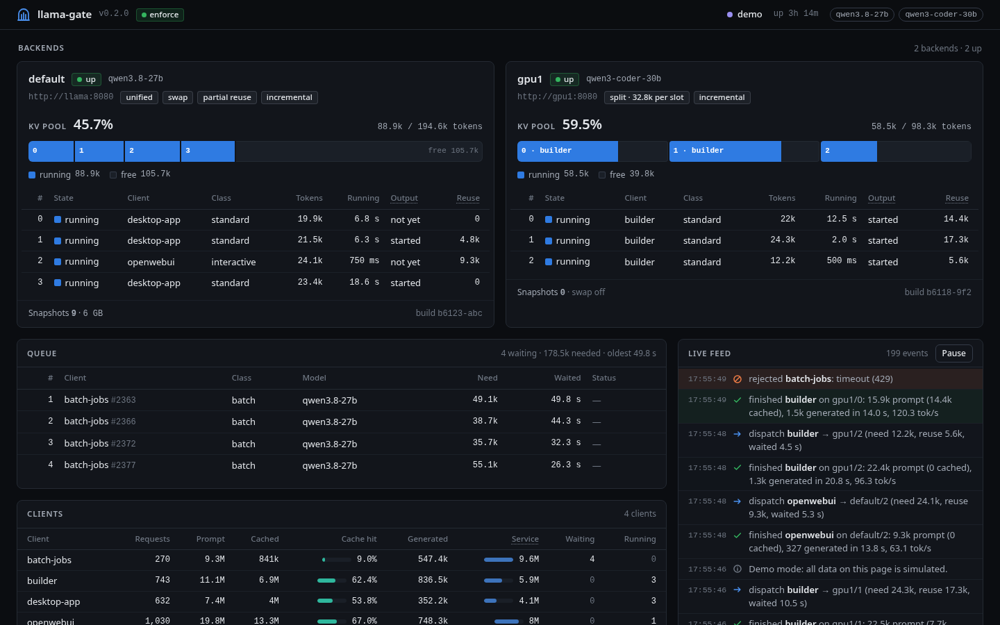
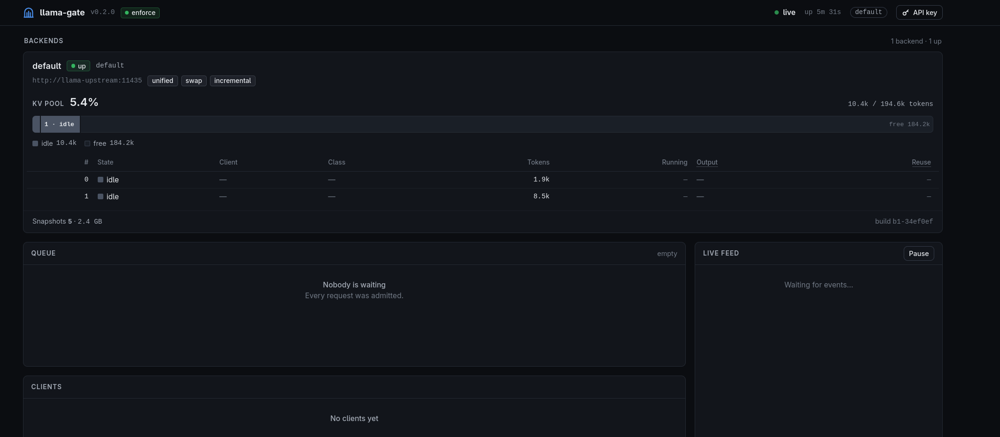

# llama-gate

**Serve many users and agents from llama.cpp without it falling over.**

A `llama-server` with several slots has a sharp edge. With a unified KV cache
(the default whenever it picks the slot count), every slot can grow into the
whole pool, and nothing stops them growing into it *together*. When they do,
llama.cpp fails **every** running request with `Context size has been
exceeded`. Clients retry, collide again, and a busy server spends its time
recomputing prompts it keeps throwing away. Its queue is first come, first
served, so one agent's burst holds everyone else off.

llama-gate is one small binary that sits in front of your llama-servers and
makes that impossible.



- **Never overfills a pool.** Every request is measured with the server's own
  template and tokenizer and admitted only when its prompt *and* its
  generation limit fit beside everything else the server holds or has
  promised. A request that does not fit waits; it is never started and then
  killed.
- **Pauses instead of failing.** Idle conversations are saved to disk to make
  room and restored in a fraction of a second when they return. An urgent
  request can pause lower-priority work that has not produced output yet:
  its progress is saved, and it resumes where it stopped, its client none
  the wiser.
- **Fair.** Clients share each server by Virtual Token Counter fair queueing
  (OSDI '24), with strict priority classes on top and backfilling for small
  requests.
- **Fast on long conversations.** Each conversation returns to the slot,
  snapshot, or server that holds its context; a common system prompt is
  shared across conversations where the model allows it; and a 90k-token
  prompt is measured in milliseconds, by tokenizing only what is new since
  its previous turn.
- **Scales out.** Several servers or GPUs behind one URL: replicas share load
  with cache affinity, other models are routed by the request's `model`, and
  a dead server's requests fail over to a live one.
- **Drop-in.** OpenAI chat, completions, and responses; Anthropic messages;
  llama.cpp completion and infill; embeddings and reranking. Clients change
  only the URL. API keys, a live dashboard, Prometheus metrics, a
  per-request access log, and configuration reloads without a restart.

## Contents

1. [How it works](#how-it-works)
2. [Install](#install)
3. [Quick start](#quick-start)
4. [Setting up llama-server](#setting-up-llama-server)
5. [Connecting clients](#connecting-clients)
6. [Configuration](#configuration)
7. [Recipes](#recipes)
8. [Deploying](#deploying)
9. [Observability](#observability)
10. [Troubleshooting](#troubleshooting)
11. [Limits](#limits)
12. [How it compares](#how-it-compares)
13. [On a real server](#on-a-real-server)
14. [Extending](#extending)
15. [Guarantees, and how they are tested](#guarantees-and-how-they-are-tested)
16. [Building from source](#building-from-source)

## How it works

A llama-server runs a fixed number of **slots** (`-np`), each holding one
conversation's KV cache: the model's memory of the tokens it has read, one
*cell* per token. With `--kv-unified` the slots share one pool of `-c`
cells; without it, each slot owns an equal share. The gate keeps a ledger of
every cell on every server, and takes each request through five steps:

1. **Identify.** An API key, a rule matching the sender's address or a
   header, or the sender's address alone names the request's *client* (who
   gets a fair share) and its *class* (how urgent it is).
2. **Measure.** The prompt is rendered with the server's own chat template
   and counted with its own tokenizer. For a conversation the gate has seen
   before, only the new turn is tokenized.
3. **Admit.** The request needs cells for its prompt plus its generation
   limit: its `max_tokens` (or its API's equivalent), or `default_generation`
   when it sets none. It starts only when that fits beside everything the
   server holds or has promised. Until then it waits, and waiting requests
   are served by class priority, then fairly between clients.
4. **Place.** It goes wherever most of its prompt already is: the slot it
   last ran in, a context saved to disk, or, with several servers, the
   server holding its conversation. Room is made by saving the least
   recently used idle context to disk and clearing its slot.
5. **Run.** The request is forwarded with its slot (`id_slot`) and granted
   limit written in, and the server's response streams back untouched.

When a request of a higher class needs room that is not there, a request of
a *preemptible* class that has produced no output yet is paused: stopped,
its progress saved, and put back in line. When it runs again it continues
from the saved state. Its client only sees a longer wait.

[ARCHITECTURE.md](ARCHITECTURE.md) explains the design in depth.

## Install

**Binaries.** Every [release](https://github.com/J-Reed700/llama-gate/releases)
has archives for Linux (x86_64 and arm64, statically linked), macOS (Intel
and Apple silicon), and Windows (x86_64). Each holds the binary, this README,
and the example configuration.

```sh
version=v0.2.0
target=x86_64-unknown-linux-musl  # or aarch64-unknown-linux-musl, x86_64-apple-darwin, aarch64-apple-darwin
curl -LO "https://github.com/J-Reed700/llama-gate/releases/download/$version/llama-gate-$version-$target.tar.gz"
tar xzf "llama-gate-$version-$target.tar.gz"
sudo install "llama-gate-$version-$target/llama-gate" /usr/local/bin/
```

On Windows, download the `.zip` for `x86_64-pc-windows-msvc`.

**Container image.** `ghcr.io/j-reed700/llama-gate` for linux/amd64 and
linux/arm64, tagged `latest`, `0.2`, and `0.2.0`. It runs as an
unprivileged user, listens on port 8080, and checks its own health.

```sh
docker run -d -p 8080:8080 \
  -v ./llama-gate.toml:/etc/llama-gate.toml:ro -e LLAMA_GATE_CONFIG=/etc/llama-gate.toml \
  ghcr.io/j-reed700/llama-gate
```

**From source,** with Rust 1.88 or newer:

```sh
cargo install --locked --git https://github.com/J-Reed700/llama-gate llama-gate
```

## Quick start

### Let the gate run llama-server

```sh
llama-gate -- llama-server -m model.gguf -c 131072
```

Point your clients at `http://localhost:8080` and open
`http://localhost:8080/gate/` for the dashboard.

Everything after `--` is the server's command line. The gate reads it to
learn how the cache is laid out (`--kv-unified`, or no `-np`, means one
shared pool; `-np` without `--kv-unified` means equal shares), then
completes it:

- The server gets a private address, `127.0.0.1` on a free port, unless you
  give it `--port`.
- It saves idle contexts to `~/.local/state/llama-gate/slots` (or
  `[eviction] directory`), unless you give it `--slot-save-path`, and its
  own idle-slot caching is turned off, so those contexts stay put until the
  gate saves them.
- It is restarted whenever it exits: after 1 second, doubling up to 30
  seconds while it keeps failing. When the gate shuts down, it stops the
  server after its own requests have drained.

### In front of a server you already run

Start llama-server on a private address with a directory for saved
contexts:

```sh
llama-server -m model.gguf -c 131072 -np 4 --kv-unified \
  --host 127.0.0.1 --port 8081 --slot-save-path /var/lib/llama/slots
```

Tell the gate where it is, how its cache is laid out, and where it saves:

```toml
# llama-gate.toml
[server]
listen = "0.0.0.0:8080"
upstream = "http://127.0.0.1:8081"

[kv]
layout = "unified"                    # "split" for a server without --kv-unified

[eviction]
directory = "/var/lib/llama/slots"    # the server's --slot-save-path
```

```sh
llama-gate --config llama-gate.toml
```

### With Docker Compose

[`deploy/docker-compose.yml`](deploy/docker-compose.yml) runs a complete
stack, with llama-server on an internal network that only the gate can
reach:

```sh
docker compose -f deploy/docker-compose.yml up -d
```

### Check that it works

```sh
curl -s http://localhost:8080/v1/chat/completions \
  -H 'content-type: application/json' \
  -d '{"messages": [{"role": "user", "content": "Say hello"}], "max_tokens": 64}'
```

The request shows up on the dashboard with its prompt size, cache reuse,
and timings, and in the log as one line. `curl -s
http://localhost:8080/gate/status` returns the same picture as JSON.

### Try it on live traffic first

`--mode observe` measures and logs every request but forwards it at once,
as if the gate were not there. You see your traffic's real prompt sizes,
generation limits, and cache reuse before anything is held back. Switch to
`enforce` (the default) when you are ready. `--mode bypass` makes the gate a
plain reverse proxy.

## Setting up llama-server

The gate works with any `llama-server` build that serves the standard HTTP
API: `/health`, `/props`, `/slots`, `/tokenize`, `/apply-template`, and the
`id_slot` and `cache_prompt` request fields. These flags matter:

| Flag | What it means for the gate |
| --- | --- |
| `-np N` | N slots: at most N requests run at once on this server. |
| `-kvu`, `--kv-unified` | The slots share one pool. llama.cpp does not report this, so tell the gate: `[kv] layout = "unified"` for a server with this flag or without `-np`, `"split"` for one with `-np` and without this flag. `llama-gate -- llama-server ...` works it out from the flags. |
| `-c N` | The pool's size (unified), or all slots' total (split). The gate reads it from `/props`; `[kv] capacity` overrides it. |
| `--slot-save-path DIR` | Lets the gate save idle contexts to `DIR` and restore them later. The gate needs the same directory as `[eviction] directory` (or a backend's `snapshots`), and must be allowed to delete files in it. Without it, idle contexts are cleared and recomputed when their conversation returns. |
| `--no-cache-idle-slots` | Recent builds keep a prompt cache in RAM and, by default, move idle slots into it as new work arrives, emptying them before the gate can save them. Turn that off (or set `LLAMA_ARG_CACHE_IDLE_SLOTS=0`, which older builds ignore); `llama-gate -- llama-server ...` does it for you. Left on, the gate stays safe but has nothing to save, and says so in its log. |
| `--api-key KEY` | List the server under `[[backends]]` with `api_key`, so the gate's own calls (measuring, slot management) authenticate. The gate then sends its key in place of the client's, so protect the gate itself with [API keys](#api-keys). |
| `--no-slots` | Leave it off: the gate reads `/slots`. |

**Tested against** upstream llama.cpp b12464 (the official
`ghcr.io/ggml-org/llama.cpp:server` image, November 2026) and a downstream
fork, with every request format, swapping, pausing, and restarts. The gate
uses only the server's documented HTTP API, so other forks and older builds
work too. A build without `/tokenize` or `/apply-template` has its prompts
estimated, and one without `--slot-save-path` has idle contexts cleared
rather than saved.

**Deleting snapshot files needs write access to the directory, not
ownership of the files.** llama-server in a container often writes them as
root; the gate can still manage them if its user can write to the
directory.

**Keep llama-server private.** The ledger is only right if every request
passes through the gate. See [Deploying](#keep-llama-server-private).

## Connecting clients

Clients change only the URL: use the gate's address where they had
llama-server's.

| API | Paths | Handled |
| --- | --- | --- |
| OpenAI chat | `/v1/chat/completions`, `/chat/completions` | scheduled |
| OpenAI completions | `/v1/completions`, `/completions` | scheduled |
| OpenAI responses | `/v1/responses`, `/responses` | scheduled |
| Anthropic messages | `/v1/messages` | scheduled |
| llama.cpp completion and infill | `/completion`, `/infill` | scheduled |
| Embeddings | `/v1/embeddings`, `/embeddings`, `/embedding` | scheduled |
| Reranking | `/v1/rerank`, `/rerank`, `/v1/reranking`, `/reranking` | scheduled |
| Slot actions | `POST /slots/{id}?action=...` | refused with 403: the gate manages slots |
| Everything else | `/v1/models`, `/health`, `/props`, `/tokenize`, `/metrics`, `GET /slots`, ... | forwarded as is |

For example:

- **OpenAI SDKs:** `base_url="http://localhost:8080/v1"`.
- **Anthropic SDKs:** `base_url="http://localhost:8080"`.
- **Open WebUI:** an OpenAI connection to `http://<gate>:8080/v1`.

The gate writes the granted generation limit into every request
(`max_tokens`, `n_predict`, and their equivalents), so a request can never
outgrow its reservation. Ask for what you need: a request with `max_tokens:
100000` holds 100k cells for as long as it runs.

### What clients see

| Situation | Answer |
| --- | --- |
| Running | The server's own response, streamed through untouched |
| Waiting, streaming | After 5 seconds, `200` and an SSE comment (`: queued`) every 15 seconds until it runs |
| Waiting, not streaming | Nothing until the answer: give such clients, and proxies in between, a generous timeout |
| Paused for more urgent work | Nothing visible; the wait is just longer |
| Prompt can never fit | `400`, `code: context_length_exceeded` |
| Waited past the class's `max_wait`, or too many queued | `429` with `Retry-After` |
| No server for its model came back within `upstream_wait` | `503` with `Retry-After` |
| The gate is shutting down | `503` with `Retry-After` |
| API key required and missing or unknown | `401` |

Every refusal carries an `x-gate-rejected-reason` header: `too_large`,
`timeout`, `queue_full`, `unavailable`, or `shutting_down`. Error bodies use
OpenAI's shape: `{"error": {"message", "type", "code"}}`. Once a waiting
stream has started, a later refusal arrives in the stream as an SSE `error`
event instead, the way llama.cpp reports errors mid-stream.

## Configuration

The gate reads one TOML file, named by `--config` or `LLAMA_GATE_CONFIG`.
Every key is optional: with no file, the gate listens on `0.0.0.0:8080` in
front of `http://127.0.0.1:8081`. `llama-gate --print-config` prints
[`examples/llama-gate.toml`](examples/llama-gate.toml), which lists every
key with its default and an explanation. That file is the full reference;
this section explains how the pieces fit.

Durations take `ms`, `s`, `m`, `h`, or `d` (`"30s"`, `"10m"`); sizes take
`KB` to `TB` or `KiB` to `TiB` (`"48GiB"`).

### Command line

| Flag | Environment | Does |
| --- | --- | --- |
| `-c`, `--config FILE` | `LLAMA_GATE_CONFIG` | Reads the configuration from `FILE` |
| `--upstream URL` | `LLAMA_GATE_UPSTREAM` | Overrides `server.upstream` and ignores `[[backends]]` |
| `--listen ADDRESS` | `LLAMA_GATE_LISTEN` | Overrides `server.listen` |
| `--mode MODE` | `LLAMA_GATE_MODE` | Overrides `server.mode`: `enforce`, `observe`, or `bypass` |
| `-- llama-server ...` | | Starts and supervises that server ([Quick start](#let-the-gate-run-llama-server)) |
| `--print-config` | | Prints the commented example configuration |
| `--check` | | Validates the configuration and exits (status 2 if it is invalid) |
| `--probe` | | Exits 0 if this gate answers its health endpoint, for container health checks |
| | `RUST_LOG` | Overrides `observe.log_level` |

### Reloading

`kill -HUP <pid>` (or `docker kill -s HUP <container>`) or `POST
/gate/reload` reads the file again. Classes, clients, keys, and the
admission, queue, and eviction settings change at once, and waiting
requests keep their place in line. Backends, `listen`, `upstream`, and
`mode` need a restart. An invalid file is refused, and the gate keeps
running on the configuration it has.

### The sections

| Section | Decides |
| --- | --- |
| `[server]` | Where the gate listens, the server behind it, the mode, the largest request body, how long running requests may finish at shutdown, health checks, and how long requests wait for a server that is down |
| `[[backends]]` | Several servers or models: each one's URL, model name and aliases, snapshot directory, API key, and layout |
| `[kv]` | The cache layout, its capacity, and a margin of cells never handed out |
| `[admission]` | Generation reservations and how prompts are measured |
| `[queue]` | Fair queueing, keepalive pings, `Retry-After`, backfilling, and how often one request may be paused |
| `[eviction]` | Saving or discarding idle contexts, which goes first, the snapshot directory and its disk budget, partial reuse |
| `[classes.NAME]` | Priority, share, waiting limits, generation limits, and whether requests may be paused |
| `[clients]` | How requests are told apart and given a class |
| `[auth]` | API keys for clients and for the gate's own endpoints |
| `[observe]` | The dashboard, logs, and where the gate's own endpoints live |

### Classes

A class says how urgent a request is.

```toml
[classes.interactive]
priority = 10          # a higher priority is always served first
max_wait = "30m"       # refuse with 429 after waiting this long

[classes.agents]
priority = 0
weight = 2.0           # within a priority, twice the share of a weight-1 class
preemptible = true     # may be paused for a higher priority
max_queued_per_client = 64
max_generation = 65536 # caps any one request's reservation
```

Priority is strict: waiting requests of a higher class are offered room
before any of a lower one, except that small requests may
[backfill](#fair-queueing) around a large one waiting for room. A *preemptible*
request is paused for a higher priority only while it has produced no
output: still reading its prompt, or not streaming. Each request is paused
at most `queue.max_preemptions` times (3), after which it runs undisturbed.
With no classes configured, every request is in one class, `standard`.

### Clients

A *client* is who gets a fair share, and its class comes from the same
match. For each request, the gate takes the first of:

1. its [API key](#api-keys): the key's `client` and `class`;
2. the first of `[[clients.rules]]` that matches its source address
   (`cidrs`), a host name's addresses (`hosts`, such as a container name,
   re-resolved every `resolve_interval`), or a header;
3. its OpenAI `user` field, as `user:<name>` (`use_openai_user`);
4. its IP address.

A key or rule without a class, and a request matching nothing, get
`clients.default_class`.

```toml
[clients]
default_class = "agents"

[[clients.rules]]
name = "chat-ui"
class = "interactive"
hosts = ["open-webui"]

[[clients.rules]]
name = "nightly-jobs"
class = "batch"
cidrs = ["10.0.5.0/24"]

[[clients.rules]]
name = "research"
header = { name = "x-team", value = "research" }
```

An application serving many people can tell them apart with an
`x-gate-client` header: it is appended to the key's or rule's name
(`chat-ui/alice`), or names the client by itself when no key or rule
applies, so each person gets their own share. A class can be
chosen per request with `x-gate-class` if you set `trust_class_header =
true`, which you should do only when every client is trusted. Set
`isolate = true` to keep each client's requests off other clients' cached
contexts, so no one can learn from cache timings what someone else sent.

### API keys

```toml
[auth]
required = true          # refuse requests without a known key (401)
admin_keys = ["env:GATE_ADMIN_KEY"]
public_metrics = true    # let Prometheus scrape without a key

[[auth.keys]]
key = "env:DESKTOP_KEY"  # read from an environment variable
client = "desktop"
class = "interactive"

[[auth.keys]]
key = "sha256:5e88..."   # printf %s "$KEY" | sha256sum
client = "ci"
```

Clients present keys as `Authorization: Bearer <key>` or `x-api-key`. A key
is written as itself, as `sha256:<hex>` so the file holds no secret, or as
`env:VARIABLE`. The gate removes its own keys before forwarding a request.
Without `required`, keys only name their clients, and an unknown key is left
for the server to judge. `admin_keys` guard the gate's own endpoints
(status, events, metrics, reload); while it is empty, those are open to
anyone who can reach the gate.

### Generation limits

Admission reserves room for a request's whole generation limit, so the
limits decide how many requests run at once.

| Key | Default | Meaning |
| --- | --- | --- |
| `admission.default_generation` | 32768 | Reserved for a request that sets no limit. Cover a reasoning model's thinking budget plus its answer. |
| `admission.max_generation` | 0 | Ceiling on any request's reservation; 0 lets only the pool limit it. |
| `admission.min_generation` | 256 | A prompt that leaves less room than this is refused with 400 instead of failing on the server. |
| `admission.enforce_generation` | true | Writes the granted limit into each request. Leave it on. |
| `admission.media_tokens` | 4096 | Cells assumed per image or audio item, which tokenizing cannot see. |

Classes may override `default_generation` and `max_generation`.

### Saving idle contexts

```toml
[eviction]
mode = "swap"                   # or "discard"
directory = "/var/lib/llama/slots"
budget = "48GiB"                # disk for saved contexts; least recently used go first
victim = "least_recently_used"  # or "smallest", "largest"
min_snapshot_tokens = 4096      # smaller contexts are cleared, not saved
partial_reuse = true
```

To make room, the gate saves an idle context to the directory and clears
its slot; when that conversation returns, the context is restored, which
takes a fraction of a second against many seconds of recomputing.
Snapshots are named `llama-gate-*.slot`, are indexed in
`llama-gate-index.json` beside them, and survive restarts of both the gate
and the server.

*Partial reuse* lets a conversation start from a context that shares only
its beginning, such as a common system prompt. Some models (hybrid and
sliding-window ones) cannot rewind to that point; the gate notices from the
reuse the server reports, turns it off for that server, and logs a notice.
Set `partial_reuse = false` to skip that learning.

### Fair queueing

Within a priority, the waiting client that has received the least service
goes next. Service is counted in tokens (`queue.input_weight` per prompt
token, `queue.output_weight` per generated token) divided by the class's
`weight`. A client that comes back after a quiet spell starts level with
the busiest waiting clients rather than with credit saved up (Virtual Token
Counter, OSDI '24). `order = "fifo"` serves strictly by arrival instead.

*Backfilling* lets a small request (up to `queue.backfill.max_tokens`) run
ahead of a large one that is waiting for room, until the large one has
waited `queue.backfill.window`.

### Several servers and models

List each server as a `[[backends]]` entry instead of `upstream`:

```toml
[[backends]]
name = "gpu0"
url = "http://127.0.0.1:8081"
model = "qwen"                   # the name clients use (default: the backend's name)
aliases = ["gpt-4o-mini"]        # more names for it
snapshots = "/var/lib/llama/slots-gpu0"
# api_key = "env:LLAMA_KEY"      # the server's --api-key
# layout = "split"               # overrides [kv] for this server
```

Entries with the same `model` are replicas. A request goes to the replica
that holds most of its conversation, else the least busy one, and requests
bound for a server that has died go to a live one. Requests choose a model by name or
alias in their `model` field; those naming none, or an unknown one, go to
`server.default_model` (by default the first backend's). Each server needs
its own snapshot directory. While no server for a model is up, its requests
wait up to `server.upstream_wait` (2 minutes), then get 503.

A llama-server in **router mode** serves several models from one URL. Give
each model an entry with that URL and `router = true`; the gate then names
the model in each request it forwards.

## Recipes

### Chat first, agents in the background

```toml
[classes.interactive]
priority = 10

[classes.agents]
preemptible = true

[clients]
default_class = "agents"

[[clients.rules]]
name = "chat-ui"
class = "interactive"
hosts = ["open-webui"]
```

Chats go ahead of every waiting agent request. Agents share what is left
fairly, and an agent request still reading its prompt is paused, and later
resumed, when a chat needs its room.

### A key per person or app

```toml
[auth]
required = true

[[auth.keys]]
key = "env:ALICE_KEY"
client = "alice"

[[auth.keys]]
key = "env:CI_KEY"
client = "ci"
class = "batch"

[classes.batch]
priority = -10
preemptible = true
```

Each key is a client with its own fair share. Behind a proxy, where every
request comes from the same address, keys are the way to tell people apart.

### Two GPUs, one model

Run a llama-server per GPU, each with its own `--slot-save-path`, and list
both under the same model:

```toml
[[backends]]
name = "gpu0"
url = "http://127.0.0.1:8081"
model = "qwen"
snapshots = "/var/lib/llama/slots-gpu0"

[[backends]]
name = "gpu1"
url = "http://127.0.0.1:8082"
model = "qwen"
snapshots = "/var/lib/llama/slots-gpu1"
```

### A chat model and a coding model

Give the entries different `model` names. Clients pick one with `model` in
the request; `aliases` cover names your clients already send, and
`/v1/models` lists the gate's names.

### A reasoning model

A model that thinks before answering needs its thinking budget reserved
too. With llama-server's `--reasoning-budget 16384`, reserve room for the
thinking plus an answer:

```toml
[admission]
default_generation = 32768
```

A smaller reservation lets more requests run at once, but a request that
runs into its limit stops mid-answer.

### Embeddings next to chat

llama-server picks the slot for embeddings and reranks itself, so on a
unified pool the gate can only run them when that server is otherwise
empty. If you embed often, run a separate llama-server with `--embeddings`
and list it as its own backend and model.

## Deploying

### Keep llama-server private

```
clients ──▶ llama-gate :8080 ──▶ llama-server :8081 (private)
                  │                      │
                  └─── slot directory ───┘
                  (the server writes, the gate indexes and deletes)
```

A request that reaches llama-server directly takes cells the gate believes
are free, and the overflow is back. Bind the server to `127.0.0.1`, or put
it on a network only the gate can reach, and publish only the gate's port.

### Docker

- Mount the snapshot directory into both containers. The paths may differ:
  `[eviction] directory` is where the gate sees it.
- The gate's user must be able to write to that directory. The example
  compose file runs the gate as root because llama-server's image writes
  snapshots as root; making the directory writable by the gate's user works
  too.
- Rules can name other containers: `hosts = ["open-webui"]` matches that
  container's address and follows it when it is recreated.
- The image's health check runs `llama-gate --probe`, which reads the same
  configuration and asks the gate's `/gate/health`.

### systemd

```ini
# /etc/systemd/system/llama-gate.service
[Unit]
Description=llama-gate and llama-server
After=network-online.target
Wants=network-online.target

[Service]
User=llama
# Saved contexts go to /var/lib/llama-gate/slots.
StateDirectory=llama-gate
Environment=XDG_STATE_HOME=/var/lib
ExecStart=/usr/local/bin/llama-gate --config /etc/llama-gate.toml -- \
    /usr/local/bin/llama-server -m /var/lib/models/model.gguf -c 131072
ExecReload=/bin/kill -HUP $MAINPID
Restart=on-failure

[Install]
WantedBy=multi-user.target
```

The configuration file may be empty, but give one: reloading reads it.

### Behind a reverse proxy or tunnel

- Point the proxy at the gate, never at llama-server.
- Let responses stream: turn off buffering, and allow long responses,
  because a queued request that is not streaming gets nothing until its
  answer. For nginx:

  ```nginx
  location / {
      proxy_pass http://127.0.0.1:8080;
      proxy_http_version 1.1;
      proxy_set_header Connection "";
      proxy_buffering off;
      proxy_read_timeout 1h;
  }
  ```

- Every request now arrives from the proxy's address, so rules by address
  cannot tell clients apart. Use [API keys](#api-keys), or a header the
  proxy sets.
- The gate's own pages are on the same port, under `/gate/`. On a public
  URL, set `[auth] admin_keys` or block `/gate/` at the proxy.

### Restarts and shutdown

On SIGTERM or Ctrl-C, the gate stops taking requests, refuses those still
waiting with 503 and `Retry-After`, and gives running ones `server.drain`
(30 seconds) to finish. Saved contexts are kept, so conversations pick up
where they were after an upgrade.

When the gate starts in front of a server that is already running, it
erases whatever the server's slots hold before using them. llama-server
reports the prompt a slot last read but not the answer that followed, so
the size of those contexts cannot be known. Contexts saved to disk are
unaffected.

When a server restarts or goes away, the gate notices within
`server.health_interval` (2 seconds), forgets what was in its slots, and
holds that model's new requests until a server is back or `upstream_wait`
runs out.

## Observability

### Dashboard

`/gate/` shows each server's pool, slot by slot (running, preparing,
preempting, evicting, idle), with who holds each slot, how long it has run,
whether its output has started and whether it can still be paused; the
queue; each client's requests, tokens, cache hit rate, and service; a live
feed of every decision; and recent requests with their timings.
`/gate/?demo` runs it on simulated traffic. When `admin_keys` are set, it
asks for one and remembers it in the browser.



### Endpoints

| Endpoint | Returns |
| --- | --- |
| `GET /gate/` | The dashboard |
| `GET /gate/status` | Everything on the dashboard, as JSON |
| `GET /gate/events` | The live feed as Server-Sent Events: `dispatch`, `finish`, `reject`, `evict`, `save`, `restore`, `preempt`, `bounce`, `backend`, `notice` |
| `GET /gate/metrics` | Prometheus metrics |
| `GET /gate/health` | `200` while the gate runs, with each server's state; always open |
| `POST /gate/reload` | Reloads the configuration file |

All but `/gate/health` and the dashboard page need an admin key when
`admin_keys` are set (`/gate/metrics` not, with `public_metrics = true`).
`[observe] path_prefix` moves them off `/gate`.

### Metrics

Named after vLLM and llm-d conventions, so existing dashboards translate.

| Metric | Type | Meaning |
| --- | --- | --- |
| `llama_gate_requests_total` | counter | Scheduled requests, by class and outcome, counted once when they end |
| `llama_gate_dispatches_total` | counter | Times requests were sent to a server, by class (a paused or bounced request is sent again) |
| `llama_gate_rejections_total` | counter | Requests refused, by class and reason (`too_large`, `timeout`, `queue_full`, `unavailable`, `shutting_down`) |
| `llama_gate_overruns_total` | counter | Contexts that finished larger than their reservation, by server |
| `llama_gate_prompt_tokens_total` | counter | Prompt tokens admitted, by how they were measured (exact, incremental, estimated) |
| `llama_gate_cached_prompt_tokens_total` | counter | Prompt tokens servers reused from their cache |
| `llama_gate_generated_tokens_total` | counter | Tokens generated, by class |
| `llama_gate_evictions_total` | counter | Idle contexts cleared to make room, by outcome |
| `llama_gate_restores_total` | counter | Saved contexts restored, by outcome |
| `llama_gate_preemptions_total` | counter | Requests paused for more urgent work (paused, declined) |
| `llama_gate_bounces_total` | counter | Requests placed again because their server refused the connection or was still loading |
| `llama_gate_upstream_resets_total` | counter | Times a server restarted or changed shape |
| `llama_gate_requests_waiting` | gauge | Requests waiting for room |
| `llama_gate_requests_running` | gauge | Requests running |
| `llama_gate_kv_capacity_tokens` | gauge | Cells the gate schedules on each server, after the margin |
| `llama_gate_kv_reserved_tokens` | gauge | Cells held or promised on each server |
| `llama_gate_kv_usage_ratio` | gauge | Reserved over capacity, 0 to 1 |
| `llama_gate_snapshots` | gauge | Saved contexts per server |
| `llama_gate_snapshot_bytes` | gauge | Disk used by saved contexts per server |
| `llama_gate_upstream_up` | gauge | 1 while a server is ready |
| `llama_gate_request_queue_time_seconds` | histogram | Time requests waited, all their waits together |
| `llama_gate_time_to_first_token_seconds` | histogram | Arrival to the first generated output reaching the client (progress events don't count) |
| `llama_gate_request_duration_seconds` | histogram | Arrival to the end of the response |
| `llama_gate_measure_seconds` | histogram | Time spent measuring prompts |

### Logs

One line per finished request (`observe.access_log`):

```
INFO gate_server::runtime: done ticket=41 client=chat-ui class=interactive model="qwen" dialect="openai_chat" backend="gpu0" slot=1 outcome="ok" status=200 prompt=7452 cached=7104 generated=757 measure_ms=3 queue_ms=0 ttft_ms=412 total_ms=15211 tokens_per_second=52.4 preempted=0 bounced=0
```

`log_format = "json"` writes the same as JSON for log collectors, and
`RUST_LOG=debug` adds a line for every request as it is queued, with its
measured prompt and reservation.

## Troubleshooting

**Requests wait a long time, or get 429.** Open the dashboard: the queue
shows what each waiting request needs, and the pool bars show what holds
the room. The usual cause is reservations. A request without `max_tokens`
reserves `default_generation` (32768), so a 64k pool runs only two such
requests at once, and a request asking for a huge `max_tokens` holds that
much. Have clients send realistic limits, or lower `default_generation` or a
class's `max_generation`. Otherwise every slot may simply be busy: add
slots (`-np`) or servers. The 429 itself comes from the class's `max_wait`
or `max_queued_per_client`.

**`400 context_length_exceeded`.** The prompt plus `min_generation` is more
than one request may hold: the whole pool (unified) or one slot's share
(split). Shorten the conversation, raise `-c`, or with a split cache, use
fewer slots or `--kv-unified`.

**`503`, no server available.** No server for the requested model was up
for `upstream_wait`. `/gate/health` shows each server's state; the server's
own log says why it is down.

**"swap off" on the dashboard, or nothing is ever saved.** The gate cannot
use the server's slot directory. Check that llama-server runs with
`--slot-save-path`, that the same directory is mounted into the gate at
`[eviction] directory` (or the backend's `snapshots`), and that the gate's
user can write to it.

**The log says the server clears idle slots itself.** llama-server runs with
its default `--cache-idle-slots`, which empties idle slots into its own RAM
cache before the gate can save them. Start it with `--no-cache-idle-slots`.

**"Context size has been exceeded" from llama-server anyway.** Something
reaches the server without going through the gate, or `[kv] layout` says
`unified` for a server that splits its cache. Make the server private, and
check the layout.

**Measuring is slow, or prompts are "estimated".** The server does not
serve `/tokenize` or `/apply-template` (an old build, or an API key the gate
lacks), so the gate estimates from the prompt's size, conservatively. If
incremental measuring disagrees with a full tokenization even once, it is
turned off for that model and logged; measuring is then correct but
slower.

**Embeddings or reranks wait for chats to finish.** On a unified pool the
server places them itself, so the gate runs them alone. Give them their own
server ([recipe](#embeddings-next-to-chat)).

**"stray" cells on the dashboard.** Cells used by requests the server
placed itself, such as embeddings. The gate counts them as taken until it
has seen them freed.

**A streaming client trips over `: queued` lines.** They are SSE comments,
which SSE clients ignore. If one does not, set
`queue.keepalive_interval = "0s"`.

## Limits

- Output that is already streaming cannot be paused: llama.cpp has no
  pause, so the only way would be to cut the stream off. A paused request
  keeps the prompt it has read; anything it had generated, unseen, is
  generated again.
- Reservations are worst case: a request holds room for its whole limit
  even if it stops early, so a pool runs fewer requests at once than it
  could hold on average.
- The gate must be the only way to the server, and there must be one gate
  per server: two gates would each believe they own it.
- Images and audio are counted at `media_tokens` each, since tokenizing
  cannot see them.
- Embeddings and reranks on a unified pool run alone.

## How it compares

llama-gate does one job: keeping each llama-server's slots safe, fair, and
cache-warm. It works alongside the tools around it.

| Need | Reach for |
| --- | --- |
| Many models, loaded on demand | llama-server's router mode, or [llama-swap](https://github.com/mostlygeek/llama-swap); put llama-gate in front |
| A fleet of llama.cpp instances | llama-gate with several backends, or [Paddler](https://github.com/intentee/paddler) |
| One gateway to many hosted providers, with spend tracking | [LiteLLM](https://github.com/BerriAI/litellm) |
| vLLM or SGLang on Kubernetes | [llm-d](https://github.com/llm-d/llm-d), [Dynamo](https://github.com/ai-dynamo/dynamo) |

What only llama-gate does for llama.cpp: admission against the shared KV
pool (prompt plus generation limit, measured with the server's own
tokenizer), fair queueing in front of a single server, pausing work that has
not produced output yet, and saving and restoring slots around all of it.

## On a real server

One RTX 3090, Qwen3.8-27B (Q5_K_S, MTP speculative decoding), two slots
sharing a 196k-token unified pool:

| | |
| --- | --- |
| A burst of agent requests that made llama.cpp abort when sent directly | 40 of 40 completed, no aborts |
| Measuring a 255k-token conversation's next turn | 84 ms, against 1.15 s tokenized whole |
| A chat arriving while a low-priority request was reading a 23k-token prompt | the request was paused 6,144 tokens in, the chat answered 4.4 s after arriving, and the paused request was restored in 279 ms and continued from token 6,144 |
| Saving and restoring idle contexts | 5.2k tokens saved in 1.5 s (228 MB); 98k tokens in 9.2 s (1.5 GB); restores in a quarter of a second |
| Sharing a system prompt on this hybrid model, which cannot rewind | detected after three requests and turned off by itself |

## Extending

Each policy is a small trait with built-in implementations, and the `Gate`
builder accepts your own:

| Trait | Decides | Built in |
| --- | --- | --- |
| `gate_core::QueueOrder` | Who goes next among equal priorities | `Vtc`, `Fifo` |
| `gate_core::EvictionOrder` | Which idle context gives way | `LeastRecentlyUsed`, `Smallest`, `Largest` |
| `gate_server::clients::Identify` | Who sent a request, its class, and whether it may be served | `Rules` (keys, networks, hosts, headers) |
| `gate_llama::Dialect` | Where an API keeps its prompt, limit, and slot options | eight request formats |

```rust
gate_server::Gate::new(config)
    .queue_order(MyOrder)
    .eviction_order(MyVictims)
    .identify(MyIdentity)
    .dialects(Dialects::standard().with(MyEndpoint))
    .serve(listener, shutdown)
    .await?;
```

[`crates/gate-server/examples/custom_policies.rs`](crates/gate-server/examples/custom_policies.rs)
implements all four. [ARCHITECTURE.md](ARCHITECTURE.md) explains where every
decision lives.

## Guarantees, and how they are tested

The scheduler is a pure state machine: events in, commands out, no clock and
no I/O. That makes it testable the way databases are:

- **No pool is ever overfilled**, and accounting never under-counts what a
  server physically holds. Checked after *every event* of a deterministic
  simulation that throws random workloads at one to three servers serving one
  or two models, with failed saves, restores and erases, server restarts and
  outages, refused connections, pauses, and embeddings landing in slots of
  the server's choosing (`SIM_SEEDS=100000 cargo test --release --test simulation`).
- **No request is lost or run twice at once**; each runs at most once more
  per pause or bounce. Same simulation.
- **Against servers that fail like llama.cpp**, a burst that overfills one
  directly completes in full through the gate, a paused request completes as
  one seamless stream, and a dead server's requests finish on a live one.
  End-to-end tests run the real gate against fake `llama-server`s with
  strict unified pools.

```sh
cargo test --workspace --release
SIM_SEED=42 SIM_TRACE=1 cargo test -p gate-core --test simulation -- --nocapture   # replay one seed
```

## Building from source

```sh
git clone https://github.com/J-Reed700/llama-gate
cd llama-gate
cargo build --release              # target/release/llama-gate
cargo test --workspace --release
docker build -t llama-gate .
```

Rust 1.88 or newer. The workspace has three crates:

| Crate | Holds |
| --- | --- |
| `gate-core` | The scheduler: a pure state machine with no I/O, and its simulation tests |
| `gate-llama` | llama.cpp's HTTP API: request formats, measuring, incremental tokenization |
| `gate-server` | The `llama-gate` binary: HTTP, configuration, the runtime, the dashboard |

## License

MIT
